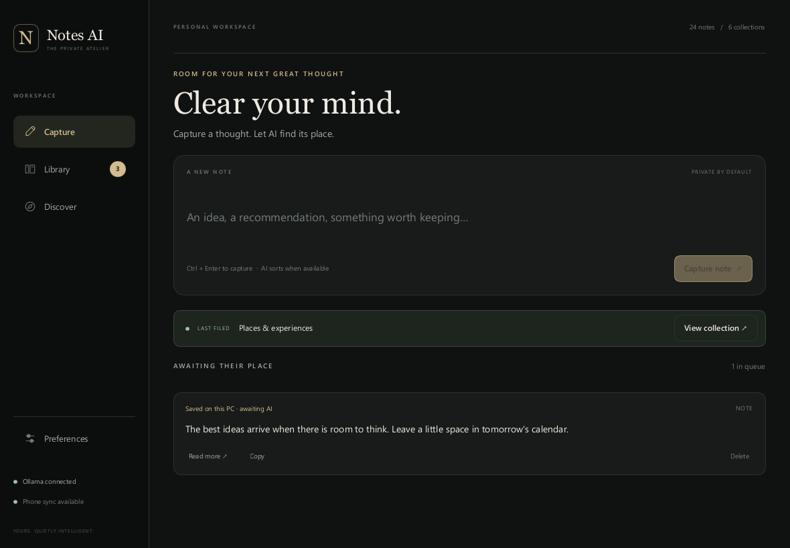
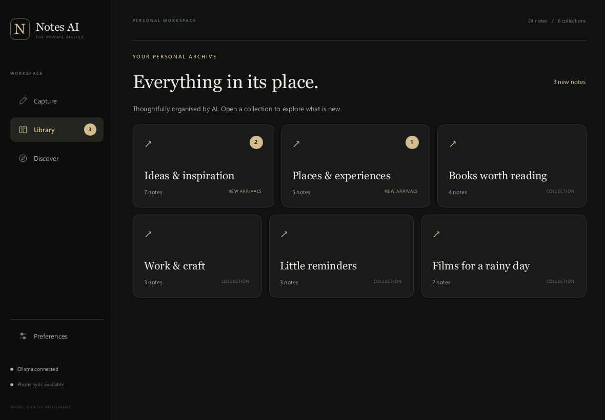
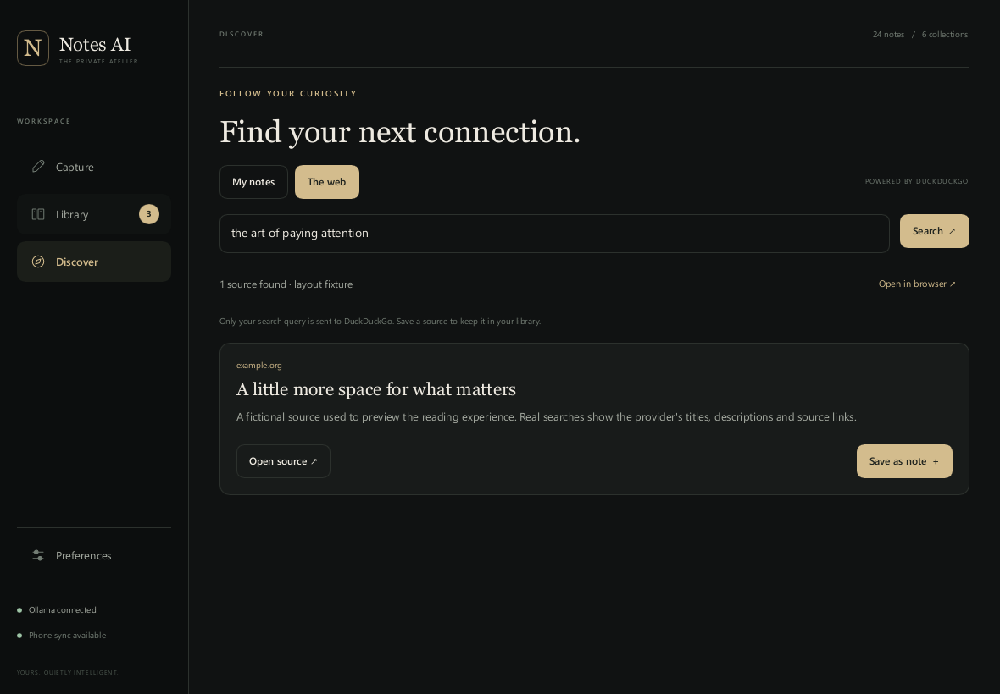

# Notes AI

A private desktop workspace for capturing thoughts, collecting sources and finding
notes by meaning. Notes AI uses local Ollama models to organise your notes into
collections, with SQLite storage and optional phone sync on your trusted network.

## The atelier interface

Graphite surfaces, warm ivory type and champagne accents. Capture, Library,
Discover and Preferences each have their own space. The previews below render
the actual Slint interface with fictional content, not personal notes.





## Features

- **Capture:** save a note immediately; AI files it when the configured models are available.
- **Library:** automatic collections, expandable notes, copy and delete, collection rename.
- **New arrivals:** circular counts per collection, a total in navigation, and an alert
  showing where the latest note was filed. Opening a collection marks its notes seen.
  Unseen counts survive restarting; old notes start read when upgrading.
- **Discover / My notes:** semantic search through the local embedding index, with
  the collection and date shown for each result.
- **Discover / The web:** DuckDuckGo results inside the app, source links and Save as
  note. Saved results keep their title, snippet and source URL and enter the AI queue.
  No API key is required. Network errors, provider browser challenges and empty
  results have separate messages; Open in browser remains available.
- **Preferences:** local model settings, live Ollama connection/model status, and
  phone server settings with pairing QR and device status.

Manual searches send your query to DuckDuckGo. Automatic classification lookup
can also send a short unfamiliar name from a note; disable it in Preferences.
Phone notes support Edit / Move and confirmed Delete with durable offline changes
and explicit conflict resolution. Both desktop and APK 0.4 must be updated.
The integration reads
its HTML search page rather than an official API, so provider markup changes or
rate limits may temporarily require the browser fallback.

## Run

Prebuilt Windows portable ZIP/EXE and Android APK are published in
[GitHub Releases](https://github.com/MbGen/notes_ai/releases).
Extract the Windows ZIP to a writable folder and open `NotesAI.exe`; it creates
its database and settings beside the executable. Personal notes are not shipped.
See [RELEASE.md](RELEASE.md) for packaging and runtime requirements.

Install Rust and the platform's native build tools, then install
[Ollama](https://ollama.com/) and pull the default models:

```sh
ollama pull qwen3:4b-thinking
ollama pull nomic-embed-text-v2-moe
cargo run --target x86_64-pc-windows-msvc
```

On Windows, Skia uses the MSVC toolchain and Visual C++ Build Tools.
If a local MSVC debug build already exists, double-click `start-desktop.cmd` to open it
with the correct working directory.

Model names can be changed in Preferences. Changing embedding models does not
rebuild old vectors; the current database expects 768-dimensional embeddings.
The desktop uses Slint's Skia renderer, restoring the renderer configuration
from the original repository to avoid uneven text rendering on Windows.
Avoid forcing `SLINT_BACKEND=winit-femtovg` when checking font sharpness.

Run from the project directory so `data/notes.db` and `data/settings.json` refer to
the existing local workspace. This directory is excluded from Git.

## Import and export

In Preferences, scroll to **Your notes. Anywhere.**

- **Export backup (.db)** saves a complete SQLite snapshot, including the search index.
- **Export JSON** creates a versioned portable archive of collections, notes, dates,
  vectors and pending queue items. Model metadata is included; settings and pairing
  keys are excluded.
- **Export Markdown** produces a readable document grouped by collection.
- **Import backup…** accepts old/new Notes AI SQLite files and JSON archives. It
  previews the counts, then merges rather than replacing existing notes. A safety
  copy is saved in `data/backups/` before importing. Imported historical notes start
  read; current unread flags are retained.

Matching notes are compared by collection, exact text and date. Intentional duplicate
occurrences in an archive are preserved. Queue receipts prevent replaying the same
archived queue item after AI has processed it. A different JSON embedding model
causes the notes to be reindexed in idle AI cycles; old SQLite files lack model
metadata, so their stored vectors are retained assuming the original model is used.
Import is transactional. Exports use a temporary file and atomic replacement; the
active database and its WAL/SHM files cannot be export destinations.

Headless commands, run from the project directory:

```sh
notes_ai.exe --inspect-backup <file.db-or-json>
notes_ai.exe --import-backup <file.db-or-json>
notes_ai.exe --export-backup <output.db-or-json-or-md>
```

## Android and local sync

Android source lives in `android/`; Pixel 9a is the intended physical test device.
Build without Android Studio with `scripts/build-android.ps1`; local tools and
caches live on D. The APK is available at `dist/NotesAI-0.4-debug.apk`.
See [SYNC.md](SYNC.md) for building, pairing, protocol and current limitations.
Android 0.4 uses the native Atelier UI: Capture, Library with recently opened collections and date sorting, and Connect with QR pairing.
The desktop hosts a local server, not a cloud relay: both devices need a network
path to the PC. Closed-app Android background sync is still pending.

## Validation and previews

```sh
cargo test --target x86_64-pc-windows-msvc
cargo build --target x86_64-pc-windows-msvc
# Optional real-provider test with a synthetic query:
cargo test live_duckduckgo_search -- --ignored --nocapture
# Render the actual screens offscreen, with sample content, without opening the database:
cargo run --example render_previews -- <output-directory> 1180 820
```

The renderer writes PPM images that can be converted to PNG with Pillow or another
image tool. Also check a 940 × 720 window, the supported minimum.

## Stack

Rust · Slint · Ollama · SQLite / sqlite-vec · Axum · reqwest / scraper.

See [TODO.md](TODO.md) for the remaining roadmap, including Android background
sync and the physical-device test checklist.
